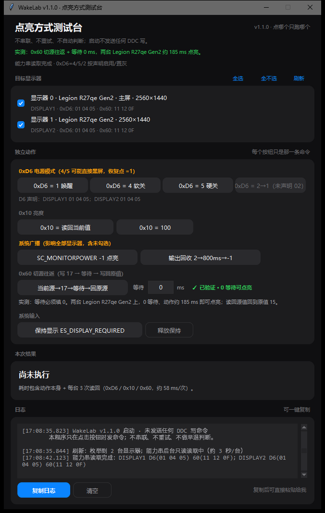

# WakeLab · 点亮方式测试台

把主程序 MonitorBrightness 的「亮屏阶梯」拆成 **11 颗独立按钮**：点哪颗就只跑哪条命令，不串联、不重试、不做「前一级失败就升级」的早退判断。用于人工对比不同显示器、不同点亮手段的真实耗时与有效性。

## 下载

- [Release v1.1.0](https://github.com/Simiely/WakeLab/releases/tag/v1.1.0)
- 资产：[WakeLab-v1.1.0-win-x64.zip](https://github.com/Simiely/WakeLab/releases/download/v1.1.0/WakeLab-v1.1.0-win-x64.zip)（14,645,108 B）
- 解压即用：`WakeLab.exe`（Windows 10/11 x64，无需安装 Python），同包附 `使用说明.txt`
- `WakeLab.exe`：14,909,381 B，SHA256 `61C4B3DF3B3077377D6B7C8099BCD618ED819CF6150388758E6A63A361F53796`
- zip：SHA256 `74A5BE26AAF954F5C75307BEBEEE655D4E657C1CA1361D856B2A26DD21D92B97`

> 首次运行若出现 SmartScreen 提示，点「更多信息」→「仍要运行」（exe 未做代码签名）。

## 快速开始

1. 启动后等待「能力串读取完成」（只读，约 3 秒/台）；期间 0xD6=4/5/2 暂不可点。
2. 在「目标显示器」勾选要测试的屏，再点任意一颗动作按钮。
3. 看「本次结果」：`动作 X ms · 含读回 Y ms`，以及每台屏的 0xD6 / 0x10 / 0x60 读回值。
4. 需要留证时点「复制日志」，日志包含目标、API、逐条耗时与读回值。

## 实测结论

**0x60 切源往返：等待必须填 0，这是已验证的用法。**

- 两台 Legion R27qe Gen2 各做一次独立测试，目标 DISPLAY2。
- 动作约 **183–188 ms**；含三次读回约 **368–372 ms**。
- 读回源值回到原值 **15**；两台显示器都适用这套逻辑。
- UI 上该按钮旁有绿色徽标「✓ 已验证 · 0 等待可点亮」，等待框默认值已改为 `0`。

## 按钮与真实 API

每次动作后只读回 `0xD6 / 0x10 / 0x60` 各一次（约 58 ms/次），只记录、不参与判断。

| 按钮 | 真实调用与参数 |
|---|---|
| 0xD6 = 1 唤醒 | `SetVCPFeature(h, 0xD6, 1)` |
| 0xD6 = 4 软关 | `SetVCPFeature(h, 0xD6, 4)` |
| 0xD6 = 5 硬关 | `SetVCPFeature(h, 0xD6, 5)` |
| 0xD6 = 2→1 | `SetVCPFeature(h, 0xD6, 2)` → 800 ms → `SetVCPFeature(h, 0xD6, 1)`；本机能力串未声明 02，默认置灰 |
| 0x10 = 读回当前值 | `GetVCPFeatureAndVCPFeatureReply(h, 0x10)` → `SetVCPFeature(h, 0x10, 当前值)` |
| 0x10 = 100 | `SetVCPFeature(h, 0x10, 100)` |
| SC_MONITORPOWER -1 点亮 | `SendMessageTimeoutW(HWND_BROADCAST=0xFFFF, WM_SYSCOMMAND=0x0112, SC_MONITORPOWER=0xF170, wParam=-1, flags=0, timeout=2000)` |
| 输出回收 2→800ms→-1 | 同一广播先发 `wParam=2`，等 800 ms，再发 `wParam=-1` |
| 0x60 切源往返 | `GetVCPFeatureAndVCPFeatureReply(h, 0x60)` → `SetVCPFeature(h, 0x60, 17)` → 等待（**填 0**）→ `SetVCPFeature(h, 0x60, 原值)` |
| 保持显示 | `SetThreadExecutionState(ES_CONTINUOUS \| ES_DISPLAY_REQUIRED)` = `0x80000002` |
| 释放保持 | `SetThreadExecutionState(ES_CONTINUOUS)` = `0x80000000` |

`0xD6=2` 置灰的原因：本机两台 Legion R27qe Gen2 的能力串是 `D6(01 04 05)`，没有声明 `02`（待机）。程序按能力串启用按钮，不盲写。

## 安全边界

- 「系统广播」两颗按钮会黑掉/点亮**全部**显示器（含未勾选的屏），恢复用 `SC_MONITORPOWER -1`。
- `0xD6=4/5` 可能直接黑屏，恢复点 `0xD6=1`。
- 启动只做显示器枚举 + 只读能力串，不调用 `SetVCPFeature` / `SendMessageTimeoutW` / `SetThreadExecutionState`。
- 不使用任何鼠标注入或自动点击（`SetCursorPos` / `mouse_event` / `SendInput`）。
- 写成功 ≠ 面板一定执行；读回只是记录，不能当作判定依据。

## 文档与构建

- 使用细节：[docs/使用指南.md](docs/使用指南.md)
- 架构与踩坑：[DEVELOPMENT.md](DEVELOPMENT.md)
- 版本记录：[CHANGELOG.md](CHANGELOG.md)
- AI/维护规则：[AGENTS.md](AGENTS.md)
- 离线自检：`WakeLab.exe --selftest`（不打开界面、不访问显示器，写 `selftest.txt`）
- 从源码打包：`python build_wakelab.py` → `dist/WakeLab.exe`

## 许可

MIT，见 [LICENSE](LICENSE)。仅用于自己的显示器测试，风险自负。
